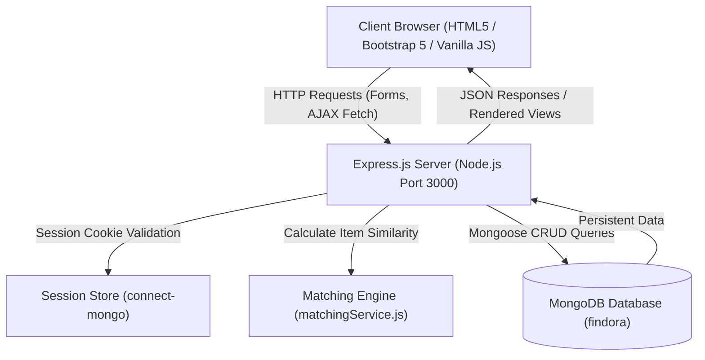

# FINDORA – Smart Lost and Found Management System with Intelligent Item Matching & Verified Claims

> **"Lost something? Let's find it."**  
> A Full-Stack College Web Technology Capstone Project built using **HTML5, CSS3, Bootstrap 5, Vanilla JavaScript, Node.js, Express.js, and MongoDB**.

---

## 1. Project Overview & Problem Statement

In universities, schools, and enterprise campuses, conventional lost-and-found management relies on manual physical logs, crowded WhatsApp groups, or open social media posts. This traditional approach suffers from serious flaws:
1. **Low Discovery Rate:** Claimants rarely find lost items because information is fragmented.
2. **Fraud & False Claims:** Anyone can see photos and descriptions in public groups and falsely claim high-value items (laptops, wallets, smartphones).
3. **Privacy Exposure:** Personal contact numbers and identification details are exposed to everyone.
4. **Lack of Organization:** Once an item is returned, posts are rarely removed, leading to duplicate inquiries.

### Project Objectives
- **Centralized Database:** Provide a structured, search-indexed portal for all campus lost and found belongings.
- **Intelligent Item Matching:** Automatically evaluate similarity between lost reports and found listings using a transparent 5-factor scoring engine.
- **Confidential Verification Workflow:** Enable finders to pose ownership verification questions and evaluate private proof before handing over property.
- **Role-Based Governance:** Provide an administrator dashboard to moderate listings, oversee claims, and ensure campus integrity.

---

## 2. Key Features

- **Responsive Modern UI:** Navy Blue (`#0f2b48`), Teal (`#0d9488`), and White color palette using Bootstrap 5 and custom CSS.
- **Robust Authentication:** Registration, login, secure session management (`express-session` + `connect-mongo`), and `bcryptjs` password hashing.
- **Item Discovery & Filtering:** Real-time search by keyword, category filter, location filter, lost/found status filter, and multiple sorting criteria.
- **Explainable Intelligent Matching:** Transparent algorithm evaluating Category (30 pts), Title/Keywords (25 pts), Color (15 pts), Location (15 pts), and Date Proximity (15 pts).
- **Confidential Verified Claims:** Claimants submit explanations and private identifying answers that are never exposed publicly.
- **User Dashboard:** Track submitted lost reports, found reports, pending claims, and test matches in real-time.
- **Role-Based Admin Panel:** System administrators can view system-wide metrics, manage users, promote/demote roles, and moderate listings.

---

## 3. Technology Stack

| Layer | Technologies Used | Description |
|---|---|---|
| **Frontend** | HTML5, CSS3, Vanilla JavaScript, Bootstrap 5, Font Awesome 6 | Responsive, accessible UI without heavy frontend frameworks |
| **Backend** | Node.js, Express.js | RESTful APIs, session management, middleware routing |
| **Database** | MongoDB, Mongoose ODM | Document database with relational references, indexes, and schema validations |
| **Security & Auth** | bcryptjs, express-session, connect-mongo | Salted password hashing, secure cookie sessions stored in MongoDB |
| **File Storage** | Multer | Local disk storage for uploaded item photos with 5MB validation |

---

## 4. Application Architecture & Communication Flow



### How the Frontend Communicates with the Backend
1. The client browser loads static HTML/CSS/JS files from Express static middleware (`/public`).
2. Client-side JavaScript (`fetch()` API) makes asynchronous REST requests (`GET`, `POST`, `PUT`, `DELETE`) to `/api/*` endpoints.
3. The Express backend validates the session cookie (`connect.sid`), processes input through sanitization and validation middleware, and interacts with MongoDB via Mongoose models (`User`, `Item`, `Claim`).
4. JSON responses are returned to the frontend, which dynamically updates the DOM without requiring full page reloads.

---

## 5. Folder Structure

```
WEB PROJECT/
│
├── config/
│   └── db.js                  # MongoDB connection setup with Mongoose
│
├── models/
│   ├── User.js                # User schema (bcrypt comparison, JSON masking)
│   ├── Item.js                # Item schema (lost/found, categories, indexes)
│   └── Claim.js               # Claim schema (claimant, status, private answer)
│
├── middleware/
│   ├── authMiddleware.js      # Session authentication & optional auth
│   ├── adminMiddleware.js     # Admin role verification
│   ├── errorMiddleware.js     # Central 404 & global error handling
│   └── uploadMiddleware.js    # Multer photo upload configuration
│
├── services/
│   └── matchingService.js     # 5-factor explainable matching algorithm
│
├── routes/
│   ├── authRoutes.js          # /api/auth (register, login, logout, me)
│   ├── itemRoutes.js          # /api/items (browse, create, update, delete, matches)
│   ├── claimRoutes.js         # /api/claims (submit, review, verify, return)
│   └── adminRoutes.js         # /api/admin (stats, users, moderation)
│
├── public/
│   ├── index.html             # Landing page with live database statistics
│   ├── login.html             # User login with demo auto-fill helpers
│   ├── register.html          # New user registration
│   ├── browse.html            # Search, filter, and browse item listings
│   ├── report-lost.html       # Report lost item form
│   ├── report-found.html      # Report found item form (with verification question)
│   ├── item-details.html      # Item details, claim submission, matching counterparts
│   ├── dashboard.html         # User dashboard (My Lost, My Found, My Claims)
│   ├── my-claims.html         # Standalone claimant status tracker
│   ├── claim-verification.html# Confidential verification portal for finders
│   ├── admin.html             # Administrator dashboard & moderation
│   ├── 404.html               # Custom 404 error page
│   │
│   ├── css/
│   │   └── style.css          # Navy blue & teal custom styling
│   ├── images/
│   │   └── logo.svg           # Scalable Findora vector logo
│   └── js/
│       ├── main.js            # Shared auth status, navbar sync, toast helper
│       ├── auth.js            # Login/Register validation & submission
│       ├── browse.js          # Search, filter, debounce, item grid rendering
│       ├── reports.js         # Report submission & immediate match modal
│       ├── dashboard.js       # Dashboard tabs, tables, item edit/delete
│       ├── claims.js          # Claim submission, review modal, handover confirmation
│       └── admin.js           # Admin stats, user role toggle, item moderation
│
├── scripts/
│   ├── seed.js                # Populates realistic demo users, items & claims
│   ├── createAdmin.js         # CLI tool to create or promote an admin
│   └── testSuite.js           # 15 automated integration tests
│
├── uploads/
│   └── .gitkeep               # Directory for uploaded item images
│
├── .env                       # Environment variables
├── .env.example               # Template environment configuration
├── .gitignore                 # Excludes node_modules, .env, and uploaded files
├── package.json               # Dependencies and npm scripts
├── server.js                  # Main Express application entry point
└── README.md                  # Comprehensive project documentation
```

---

## 6. Database Models & Schema Design

### 1. User Model (`models/User.js`)
- `name`: String, required, trimmed (2–50 chars)
- `email`: String, required, unique, lowercase, regex-validated
- `passwordHash`: String, bcrypt hashed (never returned in JSON)
- `phone`: String, optional
- `role`: String, enum: `['user', 'admin']`, default: `'user'`
- `createdAt` / `updatedAt`: Timestamps

### 2. Item Model (`models/Item.js`)
- `itemType`: String, enum: `['lost', 'found']`, required
- `title`: String, required (max 100 chars)
- `category`: String, enum: `['Electronics', 'Bags', 'Wallets and Cards', 'Documents', 'Keys', 'Clothing', 'Accessories', 'Books', 'Other']`
- `description`: String, required (max 1000 chars)
- `brand`: String, optional
- `color`: String, optional
- `location`: String, required (max 150 chars)
- `reportDate`: Date, cannot be in future
- `imagePath`: String, relative path to `/uploads/*`
- `ownerId`: ObjectId, ref: `'User'`, required
- `status`: String, enum: `['active', 'claimed', 'returned', 'deactivated']`, default: `'active'`
- `privateVerificationQuestion`: String, optional question created by finder
- `additionalDetails`: String, private/confidential identifying marks
- **Indexes:** Compound index on `{ itemType: 1, status: 1, category: 1 }` and full-text index on `{ title, description, brand, location }`.

### 3. Claim Model (`models/Claim.js`)
- `itemId`: ObjectId, ref: `'Item'`, required
- `claimantId`: ObjectId, ref: `'User'`, required
- `claimDescription`: String, required (min 10 chars)
- `privateVerificationAnswer`: String, required (confidential)
- `status`: String, enum: `['pending', 'approved', 'rejected']`, default: `'pending'`
- `reviewNote`: String, optional explanation/handover notes
- `reviewedBy`: ObjectId, ref: `'User'`, default: null
- `reviewedAt`: Date, default: null
- **Unique Constraint:** Prevents duplicate active claims by the same claimant for the same item.

---

## 7. Intelligent Item Matching Algorithm

Located in `services/matchingService.js`, this transparent, rule-based algorithm scores candidate matches on a scale of **0 to 100 points**:

$$\text{Total Score} = \text{Category} + \text{Title/Keywords} + \text{Color} + \text{Location} + \text{Date Proximity}$$

| Factor | Maximum Points | Scoring Logic |
|---|---|---|
| **Category** | **30 Points** | Exact category equality (e.g. both are *Electronics*). |
| **Title & Keywords** | **25 Points** | Tokenizes title and brand words, removes stop words, and calculates Jaccard word overlap. |
| **Color** | **15 Points** | Case-normalized color comparison or substring match (e.g. *Black* vs *Black*). |
| **Location** | **15 Points** | Normalized token overlap of location names (e.g. *Central Library 2nd Floor* vs *Central Library Reading Room*). |
| **Date Proximity** | **15 Points** | $\le 3$ days difference: 15 pts; $\le 7$ days: 10 pts; $\le 14$ days: 5 pts. |

### Match Confidence Levels:
- **75 – 100 Points:** `Strong Match` (High probability of identical item)
- **50 – 74 Points:** `Possible Match` (Moderate similarity)
- **Below 50 Points:** `Low Similarity` (Filtered out or tagged low)

---

## 8. Installation & Setup Guide (Windows / VS Code)

### Prerequisites
1. **Node.js:** Ensure Node.js (v18 or higher) is installed.
   ```powershell
   node -v
   npm -v
   ```
2. **MongoDB:** Make sure MongoDB Server is installed and running locally.
   ```powershell
   Get-Service *mongo*
   ```
   *(If stopped, start it via `net start MongoDB` in an administrator terminal).*

### Step 1: Clone / Open Project
Open the project directory in VS Code:
```powershell
cd "c:\Users\Ashwin\Downloads\WEB PROJECT"
code .
```

### Step 2: Configure Environment
Copy `.env.example` to `.env` (already configured by default):
```env
PORT=3000
MONGODB_URI=mongodb://127.0.0.1:27017/findora
SESSION_SECRET=findora_college_project_super_secret_key_2026
NODE_ENV=development
```

### Step 3: Install Dependencies
```powershell
npm install
```

### Step 4: Seed Database with Demonstration Data
Populate realistic users, lost items, found items, matches, and claims:
```powershell
npm run seed
```

### Step 5: Start Findora Server
```powershell
npm start
```
Open your browser and navigate to: **`http://localhost:3000`**

---

## 9. Pre-configured Demo Accounts

| Account Role | Email Address | Password | Purpose |
|---|---|---|---|
| **System Administrator** | `admin@findora.com` | `Admin@123` | Access `/admin.html`, view system statistics, moderate listings, change user roles. |
| **Student User (Rahul)** | `rahul@college.edu` | `Rahul@123` | Reported lost Dell Laptop and Titan Watch. Has pending claim on found laptop. |
| **Student User (Priya)** | `priya@college.edu` | `Priya@123` | Reported lost Backpack. Claim approved by Security desk. |
| **Campus Security Staff**| `campus.security@college.edu` | `Campus@123` | Reported found Laptop, Backpack, Watch, and Keys. Reviews incoming claims. |

*(Note: The login page has **Quick-Fill Demo Buttons** for each of these accounts for instant access during presentations).*

---

## 10. Demonstration Flow for Faculty Presentation

Follow this 5-minute step-by-step flow during your viva / project review:

1. **Homepage & Real Database Metrics:**
   - Open `http://localhost:3000`.
   - Point out the responsive navbar, FINDORA logo, search bar, and **live database counts** (Lost Reports, Found Belongings, Reunited Items, Verified Claims).
2. **Browse Listings & Search Filters:**
   - Click **Browse Listings**. Demonstrate instant debounced keyword search (e.g. type `"laptop"` or `"titan"`).
   - Filter by Category (*Electronics*), Location (*Library*), or Type (*Found*).
3. **Intelligent Item Matching in Action:**
   - Click on the **Dell Black Laptop with Stickers** found item.
   - Scroll down to the **Intelligent Match Counterparts** section. Show that Rahul's lost Dell Laptop appears with a **94% Strong Match**!
   - Explain the transparent scoring breakdown (Category: 30, Title: 19, Color: 15, Location: 15, Date: 15).
4. **Verified Claims Workflow (Safety & Anti-Fraud):**
   - Click **"This Belongs to Me – Claim It"**.
   - Show how the claimant must provide private verification answers (confidential proof).
   - Log in as **Campus Security Staff** (`campus.security@college.edu`).
   - Go to **Dashboard** -> **My Found Items** -> click **Review Claims**.
   - Show how the finder can see the claimant's answer, compare it with the physical item, and click **Approve Claim**.
   - Click **"Mark as Returned"** once reunited.
5. **Administrator Dashboard:**
   - Log in as **System Administrator** (`admin@findora.com`).
   - Open `/admin.html`. Show system analytics, user management (promote/demote roles), item moderation (deactivate/activate), and claim oversight.

---

## 11. Frequently Asked Viva Questions & Answers

### Q1: Why did you use Express Sessions with `connect-mongo` instead of plain JWT in LocalStorage?
> **Answer:** Storing authentication tokens in `localStorage` makes them vulnerable to Cross-Site Scripting (XSS) attacks. Using server-side sessions with `httpOnly` and `sameSite` cookies prevents JavaScript from stealing session identifiers. `connect-mongo` ensures that when the server restarts, users do not lose their login state because sessions are stored persistently in MongoDB.

### Q2: How does your Intelligent Item Matching algorithm work? Is it an AI model?
> **Answer:** No, it is an explainable, deterministic rule-based matching engine implemented in JavaScript (`matchingService.js`). It evaluates 5 normalized attributes: category matching (30 pts), tokenized keyword overlap (up to 25 pts), color equality (15 pts), location keyword overlap (15 pts), and date proximity (up to 15 pts). This ensures zero hallucination, predictable behavior, and full transparency for campus administrators.

### Q3: How do you prevent fraudulent claims on high-value items?
> **Answer:** In traditional portals, finders post full photos and serial numbers publicly, allowing malicious actors to claim items falsely. In Findora, finders can set an **Ownership Verification Question** (e.g. *"What sticker is on the laptop lid?"* or *"What is inside the pouch?"*). The claimant's answer is **confidential** and never exposed publicly; only the authorized finder or admin can view and approve the claim.

### Q4: How is input validation handled on the server?
> **Answer:** We enforce defense-in-depth: frontend HTML5 attributes provide immediate user feedback, while Express route handlers and Mongoose schemas perform strict server-side validation. We check string lengths, validate email formats using regular expressions, reject future report dates, restrict Multer uploads to image MIME types (JPEG, PNG, WEBP), and limit file size to 5MB.

### Q5: What happens if a non-admin tries to access `/api/admin/users`?
> **Answer:** The request is intercepted by our custom `adminMiddleware.js`. It checks if `req.user.role === 'admin'`. If not, it rejects the request with HTTP `403 Forbidden` and a clear JSON error message, preventing unauthorized access regardless of client-side manipulations.

---

## 12. License & Author Information

- **Project:** Findora – Smart Lost and Found Management System
- **Curriculum:** B.Tech Computer Science & Engineering (Web Technology Project)
- **Year:** 2026
- **License:** ISC
